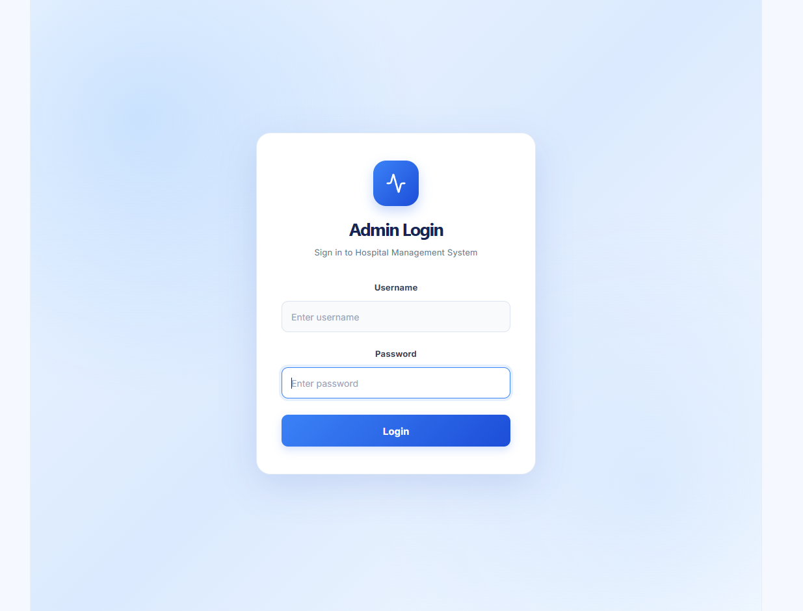
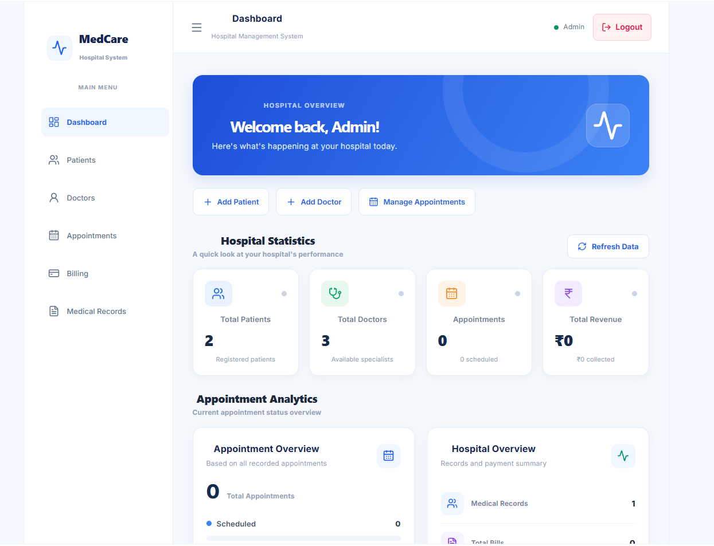
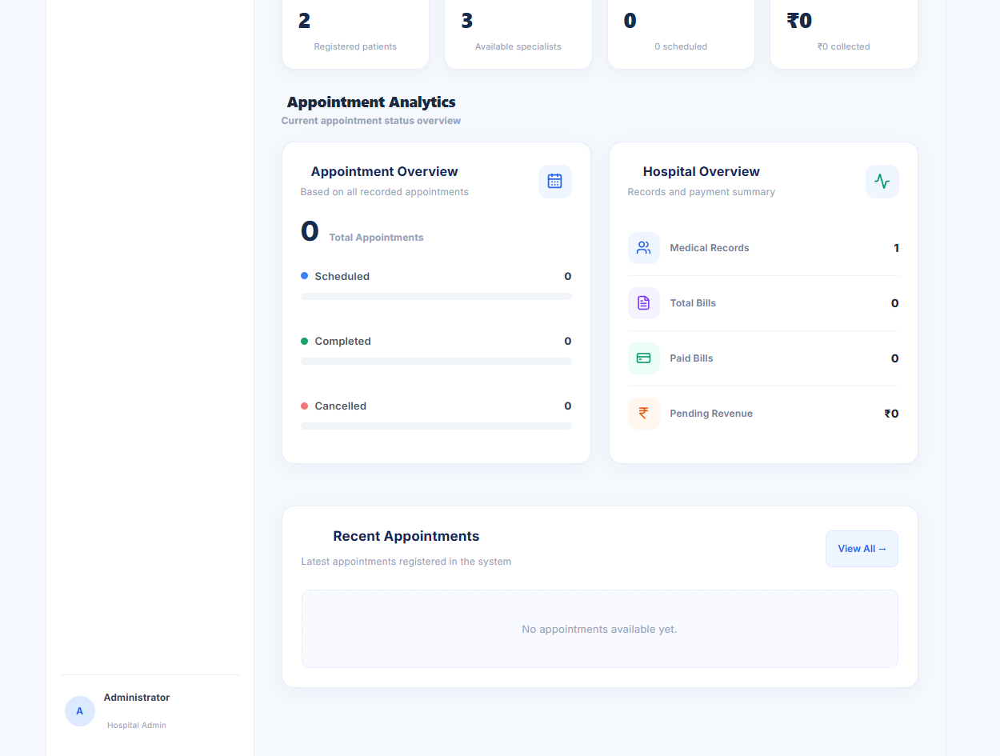
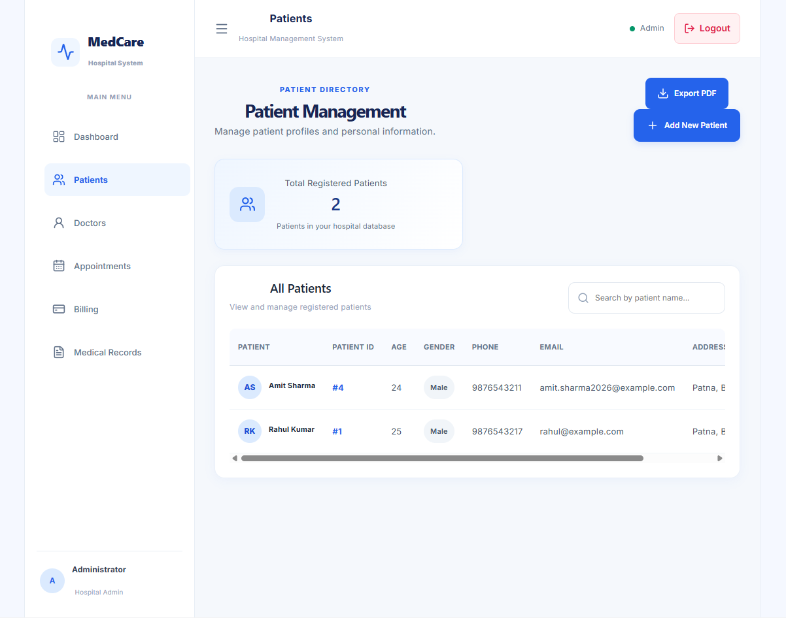
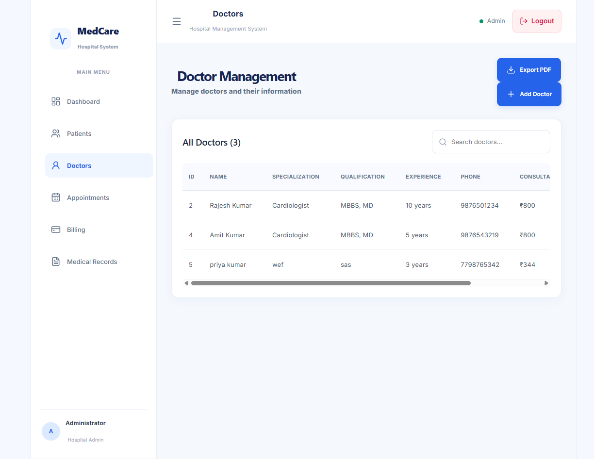

# Hospital Management System

A full-stack Hospital Management System built using React, FastAPI and PostgreSQL.

## Features

- Admin Login and Logout
- JWT Authentication
- Dashboard with hospital statistics
- Patient Management (CRUD)
- Doctor Management (CRUD)
- Appointment Management (CRUD)
- Billing and Invoice PDF
- Medical Records Management
- PDF Reports Export
- Search and Form Validation

## Technologies Used

### Frontend
- React
- Vite
- JavaScript
- CSS
- Lucide React
- jsPDF

### Backend
- Python
- FastAPI
- SQLAlchemy
- PostgreSQL
- JWT Authentication
- Argon2 Password Hashing

## Project Structure

```text
Hospital-Management-System/
├── backend/
│   ├── main.py
│   ├── models.py
│   ├── database.py
│   ├── auth.py
│   ├── create_admin.py
│   └── requirements.txt
├── frontend/
│   ├── src/
│   └── package.json
├── .gitignore
└── README.md
```

## Requirements

- Python
- Node.js and npm
- PostgreSQL
- VS Code

## Backend Setup

Open terminal:

```powershell
cd backend
```

Activate virtual environment from project root:

```powershell
..\.venv\Scripts\Activate.ps1
```

Install packages:

```powershell
python -m pip install -r requirements.txt
```

Start backend:

```powershell
python -m uvicorn main:app --reload
```

Backend URL: http://127.0.0.1:8000

API Documentation: http://127.0.0.1:8000/docs

## Frontend Setup

Open another terminal:

```powershell
cd frontend
npm install
npm run dev
```

Frontend URL: http://localhost:5173

## Environment Variables

Create a `.env` file inside the backend folder.

Add your own database connection settings and a strong SECRET_KEY.

Never upload `.env` or real credentials to GitHub.

## Admin Account

Create or reset the admin account using the appropriate backend script.

Do not store admin passwords in this README.

## Database

Create a PostgreSQL database named `hospital_db` and configure its connection in the backend `.env` file.
## 📸 Project Screenshots

### 1. Admin Login


### 2. Dashboard


### 3. Dashboard Overview


### 4. Patients Management


### 5. Doctors Management

## Project Handover Information

### Live Project Links

- **Live Website:** https://hospital-management-system-two-chi.vercel.app
- **Backend API Documentation:** https://hospital-management-system-fcwb.onrender.com/docs
- **GitHub Repository:** https://github.com/ankit-kumar4950/hospital-management-system

### Technology Stack

| Component | Technology |
|---|---|
| Frontend | React + Vite |
| Backend | Python + FastAPI |
| Database | PostgreSQL on Neon |
| Frontend Hosting | Vercel |
| Backend Hosting | Render |
| Source Control | GitHub |
| Authentication | JWT + Argon2 password hashing |

### Main Features

- Admin login and authentication
- Dashboard statistics
- Patient management
- Doctor management
- Appointment management
- Medical records management
- Billing management
- PDF exports for all five management modules

### Deployment Information

- Frontend deployed on Vercel.
- Backend deployed on Render.
- PostgreSQL database hosted on Neon.
- Environment variables are configured securely on the hosting platforms.

### Project Status

The application has been deployed and the main modules, authentication, database connection, and PDF exports have been tested successfully.

### Security Note

Never publish database passwords, secret keys, JWT tokens, or private environment variables in this repository.
